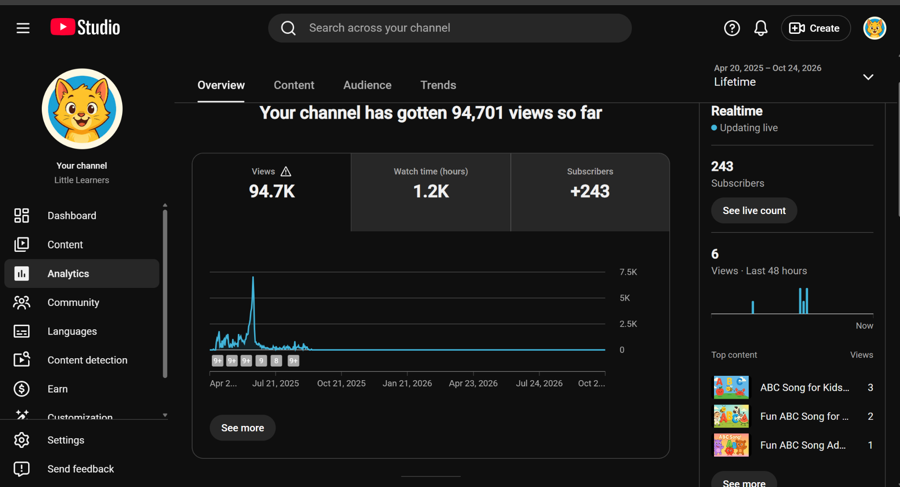
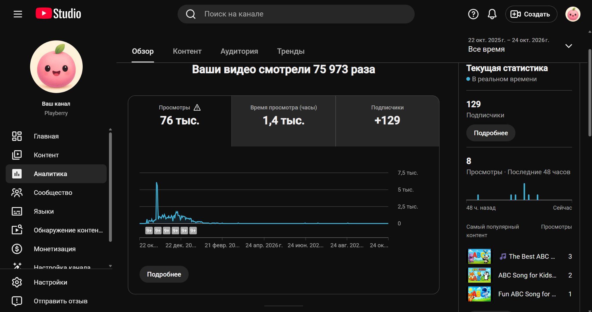

# Generative Media Pipeline

**Модульный конвейер создания видео на Python.**

Изначально проект зародился как простой скрипт на MoviePy. В ходе развития и постоянных доработок он превратился в то, что вы видите сейчас. Нынешняя версия ориентирована прежде всего на видео по английскому алфавиту — исторически это была первая задача, которую я начинал решать. Но мне хотелось уйти от жёстко связанных друг с другом частей к более обобщённой и заменяемой системе.

В новой версии процесс разделён на последовательные этапы. **Основная затея была в заменяемости разных блоков, сменить генерацию с гемени на другую обёртку, сменить озвучку с суно на ElevenLabs**

## Как это работает

```text
       СЦЕНАРИЙ           Script
           │
           ▼
         АУДИО            Audio candidates
           │
           ▼
     СИНХРОНИЗАЦИЯ        Transcript + Timing
           │
           ▼
        ВИЗУАЛ            VisualPlan
           │
           ▼
     ПОСТРОЕНИЕ СЦЕН      ScenePlan
           │
           ▼
        РЕНДЕР            final.mp4
```

Мне кажется, многие автоматизированные видео можно разложить на эту схему.

[Как данные движутся между этапами →](docs/PIPELINE.md)

## 01. Сценарий — о чём будет ролик

Первый шаг в зависимости от заданого рецепта мы должны сгенерировать смысловое наполнение ролика, текст который будет проговариваться, сцены которые будут меняться и так далее, Если бы мы делали новостники, это был бы парсер новостей в связке с условной LM по их обработке перед генерацией.

Для алфавита например, это означает, что строка про букву A должна относиться к объекту на A, а дальше должна идти B. На практике была набита шишка **надо проверять текст перед отправкой на озвучку на полноту и галлюцинации**

Сейчас сценарии пишет Gemini, а правила задаёт `Recipe`. Для другого формата можно написать новый рецепт; для другой LLM — адаптер текстового провайдера. Это потребует реализации и проверок, но не переделки всей системы.

**Главная инженерная задача этого блока:** превратить вероятностный ответ модели в предсказуемые данные в нужном формате для следующих этапов.

[Подробнее о сценарии →](docs/stages/01-scripting.md)

## 02. Аудио

Нужные блоки сценария превращается в звук. Сейчас для песен подключён **сторонний SunoAPI**: он асинхронно генерирует музыку и всегда возвращает две версии одной песни. Чтобы не выбрасывать нормальные рабочие песни, было принято решение в какой-то момент каждую доводить до ролика, отсюда родилось асинхронное направление и параллельные задачи. 

В этих задачах мне было достаточно обычного суно, но на практике может понадобиться и нормальный голос, очевидным решением будет подключение ElevenLabs, кстати они тоже умеют песни генерировать, но когда это всё делалось не умели. Архитектурно заложена дорога подключение других провайдеров звука, но решения под что-то конкретное пока не прописывалось.


[Подробнее об аудио →](docs/stages/02-audio.md)

## 03. Синхронизация — когда именно что звучит

Чтобы правильно выстроить сцены, смены кадров, переходы и вообще сам ролик необходимо знать время каждой фразы, на первых итерациях я пользовался промптованным Gemini, потом перешёл на локальный WhisperX, но в конце под задачу алфавита пришёл к удобному для меня лично, допзапросу к апишке суно, которые стоил крайне мало.

Интересный факт, недостаочно проверить текст который мы отдаём на озвучку, важно проверять ещё что вышло на итоге, я пару раз обжигался на кривой генерации песни, дополнительная проверка выросла отсюда

Этот этап обязателен для любого ролика, подготовка к раскадровке, но зависить от определённого источнкиа не должен, так как озвучек может быть много и под каждую будет свой способ удобнее, блок также заменяем.

[Подробнее о синхронизации →](docs/stages/03-alignment.md)

## 04. Визуальное наполнение — что показывать

На этой стадии выбираются изображения и фон для каждого фрагмента. Моё решение предполагает собрание локальной бибилотеки, я выкачивал пачкам гифки на GIPFY, фоны генерировал с нейронкой сам. Затем каждый объект описал в одну огромную сборку, которая как раз отправляется при генерации текста, чтобы модель делающая текст не придумывала животных/предметы/вещи, а делала песню на те слова, которые у меня уже установлены локально и которые я смогу спокойно вставить в ролик.

Этот блок моджно дорабатывать сильно. Сделать разные наборы ассетов, тематические фоны, несколько вариантов одного объекта, свои правила художественного выбора. Под другую задачу можно полностью изменить логику визуального подбора, например генерацию нужных фотографий под конкретный ролик, либо поиск по интернету подходящих изобржаений.

[Подробнее о визуальном наполнении →](docs/stages/04-visuals.md)

## 05. Построение сцен — как всё будет выглядеть

Этап на основе полученой транскрибации и всех файлов что у нас негенерировались, насобирались к данному видео, собираем в понятный формат для Moviepy

На примере алфавита тут решается, где находится буква, какого она цвета, сколько места занимает GIF, когда начинается движение и сколько длится сцена.

[Подробнее о построении сцен →](docs/stages/05-scene-planning.md)

## 06. Рендеринг — превращаем план в MP4

Последний этап получает готовый `ScenePlan`, изображения, субтитры и аудио и втупую собирает их по шаблону.

Сейчас для работы с изображениями используется Pillow, а MoviePy и FFmpeg участвуют в сборке и кодировании файла. Вся логика конкретного образовательного формата остаётся за пределами renderer.

Такая граница позволяет в будущем заменить рендер-движок, не переписывая сценарий и музыку. Но пока здесь реализован один renderer и переделывать его логику наверное стоит в последнюю очередь когда можно играть с Recipe

[Подробнее о рендеринге →](docs/stages/06-rendering.md)

## Что держит всё вместе

Над этими этапами работает **`Pipeline`**: управляет их порядком, проверками и восстановлением после ошибок. **`JobStore`** записывает состояние задания и промежуточные результаты. **`Providers`** скрывают детали внешних API, а **`Recipes`** задают правила конкретного типа ролика.


[Подробная архитектура →](docs/ARCHITECTURE.md) · [Как добавлять свои рецепты и провайдеры →](docs/EXTENDING.md)

## Отдаю готовым

Тут уже есть два образовательных формата: **Alphabet** (буквы английского алфавита) и **Counting** (обучение счёту). Реальные песни создаются с помощью Gemini и стороннего SunoAPI.

### Результаты

Вся история затевалась как эксперимент с полной автоматизацией производства контента для YouTube и попытка понять, к чему такой подход вообще может привести.

За время эксперимента я запустил четыре канала. Два канала были потеряны, поэтому ниже только результаты тех, статистику которых удалось сохранить.

За несколько месяцев работы на двух каналах получилось:

**Little Learners**
- 94 701 просмотр
- Около 1 200 часов просмотра
- 243 подписчика (252 на пике)

[Канал](https://www.youtube.com/@little-learn) · [Пример видео](https://www.youtube.com/watch?v=Pk-5JQWTP2g)



**Playberry**
- 75 973 просмотра
- Около 1 400 часов просмотра
- 129 подписчиков (134 на пике)

[Канал](https://www.youtube.com/@Playberry-Learn) · [Пример видео](https://www.youtube.com/watch?v=36ctMTdDz6w)



**Итого: более 170 тысяч просмотров и около 2 600 часов просмотра при минимальном ручном участии в производстве каждого ролика.**

При этом ролики продолжали выходить параллельно с развитием самого генератора. Я постепенно добавлял новые функции, менял способы генерации, исправлял ошибки и удалял себя из процесса генерации.

Основные расходы приходились на генерацию музыки через SunoAPI и прокси для каналов. Точную сумму уже не вспомню, но больших денежных вложений эксперимент не потребовал. Время, потраченное на разработку и постоянные доработки скрипта, в эту оценку не входит.


## Установка и документация

[Установка, подключение API и запуск на Windows →](START_HERE.md)

[Все этапы и их контракты →](docs/PIPELINE.md) · [Внутреннее устройство →](docs/ARCHITECTURE.md) · [Расширение системы →](docs/EXTENDING.md)

## Лицензия

Проект распространяется по [лицензии MIT](LICENSE). Она разрешает в том числе коммерческое использование кода. Права на сторонние изображения, музыку и шрифты определяются их собственными лицензиями.
